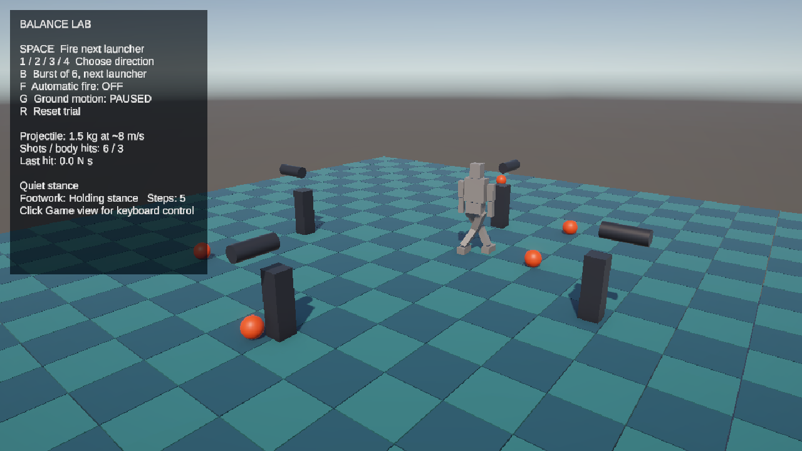

# Walker

A physics-simulated humanoid in Unity that balances on its own and takes recovery steps when it gets pushed. It has no animations. Balancing and stepping use only torque-limited `ConfigurableJoint` drives, with no root forces or body-position corrections.



## Running it

You need Unity **6000.6.8f1**. Other versions haven't been tested.

1. In Unity Hub, choose **Add > Add project from disk** and select this folder. The first open downloads packages and rebuilds the `Library` folder, which takes a few minutes.
2. Open `Assets/Scenes/SampleScene.unity` and press Play.
3. Click the Game view so it receives keyboard input.

| Key | Action |
|---|---|
| Space | Fire the next of four launchers |
| 1–4 | Fire a specific launcher |
| B | Fire a burst of 6 balls, 0.1 s apart, from the next launcher |
| F | Turn automatic fire on or off |
| G | Pause or resume the moving floor |
| R | Reset the trial |

The floor starts out moving, which is the hardest case. Press G and then R for flat ground.

## How it works

**Standing.** `JointBalanceHumanoid` estimates the capture point, the spot where the body would come to rest if its foot were placed there. It feeds the error back through the ankles, hips, spine, knees and arms as joint targets.

**Stepping.** `HumanoidFootwork` takes over when the capture point moves beyond what standing feedback can manage:

1. The foot nearest the capture point stays down, and the other steps to where the body would come to rest. The target is limited to what a nearly straight leg can reach, and recomputed every physics tick.
2. A bigger push takes several short steps.
3. Once the body settles, a pelvis-controlled hold brings it to rest in whatever stance the feet landed in.
4. A closing step returns the feet to a normal stance if they need it, and standing feedback takes over again.

A few settings matter if you change things:

- **Fixed timestep:** this must be 0.01 s, as saved in `ProjectSettings/TimeManager.asset`. At Unity's default of 0.02 s the humanoid falls while standing untouched.
- **Torque limits:** the knee is limited to 280 N·m and the hip to 300 N·m. Set them with `Maximum Force` on the Slerp Drive of the Shin and Thigh joints.
- **Scene values:** values saved in the scene override the defaults in code, so a changed default has no effect until the scene is updated too.
- **Split feet:** `splitFeet` on the humanoid hinges each foot at the ball, with a human toe joint's range. It is off: it neither helped nor hurt measurably. See [ARENA.md](Assets/Walker/Platform/ARENA.md).

## Project layout

```
Assets/Walker/
  Humanoid/   The controller: JointBalanceHumanoid, HumanoidFootwork, FootContactSensor
  Platform/   The test arena: moving floor, ball launchers, materials, scene builder
  Testing/    Benches and fixtures, which use both of the above
Assets/Scenes/SampleScene.unity   The scene to open
BalanceResults/                   Bench output (only the results the docs cite are tracked)
Docs/                             Images for this README
```

The humanoid code doesn't reference the platform or testing code.

## Results

Measured on 2026-11-07 with `RecoveryStepBench`, three runs per case, on flat ground unless noted. A run passes if the humanoid stays up and is moving slower than 0.15 m/s at the end. Balls are 1.5 kg at about 8 m/s.

| Scenario | Passed |
|---|---|
| 1 to 5 balls, 0.1 s apart, from each of 8 directions | 119/120 |
| 6 balls, 0.1 s apart, from each of 8 directions | 22/24 |
| 6 balls, mixed directions | 12/12 |
| Second hit 1 s after the first step lands: 40 N·s push, then another | 88/96 |
| Second hit 1 s after the first step lands: 4 balls, then 4 more | 88/96 |
| Two pushes 3 s apart | 11/12 |
| 6-ball bursts with no reset, 6 s apart | 7/9 |
| 6-ball bursts with no reset, 3 s apart | 5/9 |
| Moving floor: pushes and one or two balls | 41/51 |

Pushes at the pelvis hold up to 70 N·s forward, and up to 60 N·s backward and sideways, which is the most the bench tries in those directions.

### Moving floor

The scene's floor moves each slab up to 10 cm and tilts it up to 7 degrees, out of step with its neighbours, so most steps land on a different slab across a stair. Between neighbours front to back, the step is over 7 cm about half the time and reaches 22 cm. This is much harder than flat ground, and the humanoid often falls.

| Moving floor, 8 directions, repeats not used for tuning | Passed | Fell |
|---|---|---|
| 1 ball (3 runs per direction) | 24/24 | 0 |
| 2 balls (12 runs per direction) | 74/96 | 16 |
| 3 balls | 52/96 | 35 |
| 4 balls | 44/96 | 35 |
| 5 balls | 38/96 | 52 |
| 6 balls (24 runs per direction) | 77/192 | 104 |
| 6 balls, mixed directions (3 runs per case) | 12/12 | 0 |
| No balls, one foot where four slabs meet (3 runs per case) | 22/36 | 13 |
| Same, with the floor still | 36/36 | 0 |

Each repeat starts about 0.4 s later than the last, so the runs meet the slabs across their whole cycle. Three settings for uneven ground (`roughClearance`, `pathClearance`, `stepDownLead`) cut the 6-ball falls from 137 to 104 and leave level ground unchanged. [ARENA.md](Assets/Walker/Platform/ARENA.md) has what goes wrong on this floor, the before-and-after numbers, and what was tried and rejected.

Known limits:

- Burst after burst with no reset is less reliable than a single burst.
- The moving floor is by far the weakest case. From three balls in one direction, about half the runs or more fail. See [ARENA.md](Assets/Walker/Platform/ARENA.md) for why.
- Outcomes near the limit are chaotic, so a single run says little. Run the bench with `repeats` of at least 2 after any tuning.
- The camera doesn't follow, so a long run of bursts can walk the humanoid out of frame and eventually off the floor.
- Self-collision is off, so the legs can pass through each other on a crossing step.

## More detail

- [ARENA.md](Assets/Walker/Platform/ARENA.md): arena settings, how to run the bench, and full results, including a comparison with a 240 N·m hip.
- [RESEARCH.md](Assets/Walker/Humanoid/RESEARCH.md): the papers behind the controller, and what was learned on this rig.
